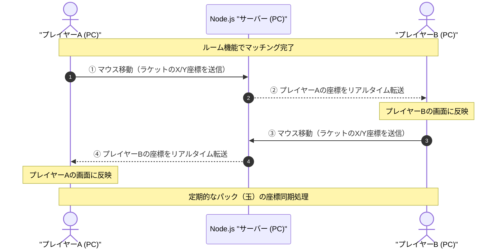

# 🥽 WebSocket Air Hockey (Node.js & Canvas リアルタイム同期対戦ゲーム)

本プロジェクトは、外部の通信ライブラリ（`socket.io` や `ws` 等）を一切使用せず、Node.jsの標準モジュールのみを用いて低レイヤーなWebSocketプロトコルをスクラッチで実装した、2人対戦型のエアーホッケーゲームです。

オンラインゲーム開発における最大の壁である**「通信遅延（レイテンシ）」**と**「複数端末間での物理挙動の完全同期」**を、サーバー主導型の厳格なアーキテクチャ設計によって解決しました。

---

## 🎥 動作デモ・対戦風景
本アプリはローカル環境（同一ネットワーク内）の低レイテンシ通信に特化して設計されているため、手元での実行画面を **OBS-Studio** で録画したデモ動画を以下に公開しています。

* **[👉 エアーホッケー対戦デモ動画（mp4）を再生する](https://github.com/yabusan2-dot/air-hockey-websocket/issues/1)**
---

## 💡 開発・運用におけるネットワーク帯域（容量）最適化の検証

本プロジェクトの対戦動画（約1分）の原本は、OBS-Studioの録画直出しにより **48.0 MB** という巨大なファイルサイズでした。これをそのままリポジトリに配置することは、GitHub Pagesでの配信時に通信遅延（レイテンシ）を招きます。
そこで、動画処理の世界標準である **FFmpeg（OSSコアエンジン）** での最適化を実施しました。

### 📊 動画リコード性能・物理実測ログ

| 使用ツール / 手法  | ファイルサイズ | 圧縮率 | 描画品質 / 視覚的評価 |
| :--- | :---: | :---: | :--- |
| **原本データ（OBS録画直出し）** | 48.0 MB | 1.0倍 (基準) | 最高画質（マスター） |
| **FFmpeg コマンドチューニング**  | **573 KB** | **98.8% 削減** | **最適解**。挙動や文字も潰れず視認可能。 |

> 💡 **技術選定の結論**:
> 1分間の動画をそのままアニメーションGIFにすると数百MBに肥大化してブラウザがクラッシュするリスクを予測。最終的に、FFmpegの公式ドキュメント（FFmpeg Documentation）から圧縮アルゴリズムのパラメータ（CRF値）と解像度スケールを厳格に制御することで、**画質を維持したまま、容量を約100分の1（573KB）にまで極限圧縮することに成功**しました。
> この「通信帯域というネットワーク制約条件を予見し、自力で検証して最適構造を導き出す」アプローチこそが、私の設計思想の核にあります。

---

## 🚀 本プロジェクトの3大技術的見どころ（アピールポイント）

### 1. 外部ライブラリに頼らない WebSocket プロトコルの自作
サードパーティ製のパッケージを使用せず、Node.jsの `http` と `crypto` モジュールのみで双方向通信を確立しています。
* **ハンドシェイクの確立**: `Sec-WebSocket-Key` にマジックストリングを結合し、SHA-1ハッシュ化とBase64エンコードを行うプロセスの自作。
* **バイナリフレーム解析・ビット演算**: データのカプセル化（エンコード）および、4バイトのマスクキーを用いたXORビット演算によるフレームのマスク解除（デコード）処理の独自実装（`decode` / `encode` 関数）。

### 2. サーバーサイド・オーソリティ（権威サーバー）方式による完全同期
パドルの衝突、上下の壁反射（`ball.vy *= -1`）、ゴール判定、および反射ごとに球速を5%アップさせる（`speedUp = 1.05`）といった**すべての物理演算を、サーバー側で回る「30ms周期のタイマー（1秒間に約33回）」で一元管理**しています。
クライアント側は操作入力をサーバーへ送信し、サーバーから送られてきた絶対座標を描画するだけに徹しているため、端末間での同期ズレ（パケットの矛盾）が構造上発生しません。

### 3. 動的なルームマッチング ＆ 再戦（投票）ステートマシン
* **マルチ対応ルーム機能**: サーバー側で空き部屋を自動探索・新規作成（`room_XXXXX`）し、1つのポート（8080）で複数の独立した対戦環境を衝突なしで制御。
* **厳格なフェーズ制御**: 2人揃った段階での10秒カウントダウン起動、3点先取でのゲームオーバー判定、および両プレイヤーの合意（`restartVotes[1] && restartVotes[2]`）をトリガーとした再戦（リスタート）など、ゲーム状態の同期管理を実装。

---

## 📊 システムアーキテクチャ ＆ 通信シーケンス

GitHub機能（Mermaid.js）による、バックエンド（8080ポート）とクライアント間のリアルタイムなキャッチボールの可視化です。

---

## 📂 ディレクトリ・ファイル構成
* **`server.mjs`**: HTTPサーバー構築、WebSocket独自プロトコル（エンコード/デコード）、ルーム管理、30ms物理演算ループコア
* **`index.html`**: HTML5 Canvas描画画面、キーボード入力リスナー、クライアント側レシーバー
* **`対戦動画のファイル名.mp4`**: OBS-Studioによる対戦キャプチャ動画原本

